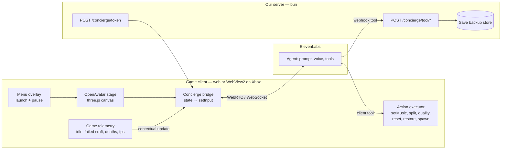

# AI concierge avatar (Detroit-style) — feasibility study

Date: 2026-10-30
Scope: quick investigation, no implementation. Answers: can Giera get a top-quality, welcoming AI avatar in the
main menu and pause menu that helps a non-reading child start the game, enable the mic, notice when they are
stuck, and act on the game through tools — on web and on Xbox?

## Bottom line

Feasible on web with the stack as it stands. Three pieces already exist or are cheap:

1. **Body**: [`@openavatar/three`](https://github.com/Enconvo/OpenAvatar) renders a `.openavatar` JSON character
   straight into our three.js version, with `listening / thinking / speaking` states, mouth driven by a `voice`
   level, and gaze. Zero asset pipeline — the body is meshed from a JSON file.
2. **Brain**: ElevenLabs Agents (`@elevenlabs/client`) gives WebRTC voice, barge-in, Polish, and **client tools**
   (the agent calls our game functions) plus **webhook tools** (server-side).
3. **Hands**: the game already has a tool-calling LLM path for NPCs (`server/npc-reason.ts` → `walk_to`,
   `give_block`). The concierge reuses that shape, not that code.

Two honest caveats:

- **Live voice on Xbox is unverified.** WebView2 exists on Xbox UWP since 2023, but `getUserMedia` + WebRTC there is
  undocumented. Probe before promising. Fallback that keeps the feature: text conversation over WebSocket + our own
  TTS audio. The child still hears the avatar; they answer with the pad instead of the mic.
- **Cost per minute is real.** $0.08/min live call. A 5-minute chat is $0.40. Recommend: pre-generated clips for the
  90 % path (repo already has `scripts/generate-audio.ts`), live agent only when the child asks for it.

## What the two upstreams actually give us

### OpenAvatar (`Enconvo/OpenAvatar`, Apache-2.0 code / CC BY 4.0 spec+examples)

- One `.openavatar` JSON per character: body from soft solids (SDF), materials (felt, fur, glass…), face, parts,
  props, and reaction rules per state/activity.
- `@openavatar/three@0.1.0` on npm (published 2026-10-25), peer `three >= 0.160` — we run 0.186.1. Ships raw ESM, no
  build step, no runtime deps.
- Two integration modes:
  - `new OpenAvatar(doc).object` → drop into our existing scene, call `setInput()` + `update(dt)`.
  - `new OpenAvatarStage(canvas)` → self-contained menu widget. **This is the right one for the menu**: separate
    canvas in the DOM overlay, no interference with `PostFX`, CSM cascades or split-screen viewports.
- Host inputs (SPEC 12.1) map 1:1 onto our needs:

  | Input | Source in Giera |
  |---|---|
  | `state` | agent `onModeChange` (`listening` / `speaking` / `thinking`) |
  | `voice` 0–1 | `conversation.getOutputVolume()` or `getOutputByteFrequencyData()` |
  | `mic` 0–1 | `conversation.getInputVolume()` — also a free "we can hear you" indicator |
  | `viseme` | `onAudioAlignment` (character timing) later; not needed for v1 |
  | `activity` | `thinking` while a tool runs, `sleeping` when idle 60 s |
  | `userActivity` | `playing`, `browsing`, `away` from our own telemetry |
  | `expression` | agent-picked mood per reply (happy / surprised / thinking) |
  | `pointer` | mouse position in menu → avatar looks at the cursor |

- Risk: 0.1.0, 0 stars, single vendor, spec still 0.1. Mitigation: it is one JSON + one ESM package; a stub avatar
  behind the same `setInput` interface keeps the game shippable if the package rots. Do not let the concierge be the
  only path to starting the game.

### ElevenLabs Agents

- `Conversation.startSession({ conversationToken | signedUrl | agentId, clientTools, overrides, ... })`.
  Voice = WebRTC (needs `getUserMedia` after a user gesture), text-only = WebSocket.
- Private agent ⇒ our server mints the token (`/v1/convai/conversation/token`, `XI_API_KEY` server-side only).
  `server/index.ts` is the natural place; key never reaches the client.
- **Client tools**: agent calls `async ({...args}) => result`, optionally waiting for the return value. This is how the
  avatar "does things" in the running game.
- **Webhook tools**: agent POSTs to our server. Use for anything that must survive the client (backups, bug reports).
- `sendContextualUpdate(text)` pushes state to the agent **without** forcing a turn — the mechanism for
  "spot the child struggling". `sendUserMessage(text)` forces a turn (typed fallback). `sendUserActivity()` stops the
  agent talking over the child.
- Personalisation: `overrides` (first message, system prompt, language, voice, ASR keywords) or Dynamic Variables.
  Requires enabling each field in the agent's Security tab.
- Pricing: $0.08/min call, $0.003/text message. Free 15 min/mo, Starter 75, Creator 275, Pro 1 238.

## Architecture

### Where it lives

- **Launch menu** (`src/client/startup/launch-menu.ts`): avatar stands beside the existing split-screen + music
  controls. It is the thing that talks a non-reader through `Zaczynamy!`.
- **Pause menu**: does not exist yet. Build it as the second host of the same overlay component — same avatar
  instance, same conversation, same tools. Adding a pause menu is required work regardless; the concierge is a
  consumer of it, not the reason for it.

### Tool catalogue

All of these already have an implementation site in the repo or are one-line calls; none need new subsystems.

Client tools (execute in the game, return a short result to the agent):

| Tool | Effect | Guard |
|---|---|---|
| `setMusicTrack` | `audio.playMusic(id)` | none |
| `setSplitScreen` | `splitScreen.setSplitScreen(bool)` | none |
| `setGraphicsQuality` | AO/Bloom/render scale ladder | none |
| `setVolume` | master volume | none |
| `startTutorial` | scripted walk/jump/mine demo | none |
| `highlightControl` | pulse a HUD button or key hint | none |
| `teleportToSpawn` | reposition player | none |
| `spawnProp` | drop a training dummy / star near player | whitelist of ids only |
| `saveNow` | `saveGame()` | none |
| `resetProgress` | wipe save | **two-step**: agent asks, child confirms on-screen, server issues one-time token |
| `restoreBackup` | load newest backup | same token gate |
| `reportBug` | screenshot + state → server | none |

Webhook tools (server side):

| Tool | Effect |
|---|---|
| `getSaveSummary` | tier, stars, playtime — for "you're on level 6!" |
| `backupNow` / `listBackups` | versioned copies of the save JSON before any destructive action |
| `getChangelog` | what changed since the child last played |
| `getKnownIssues` | honest answer when something is broken |

Rule: **destructive tools never run on the agent's word alone.** The confirmation is a big icon button in the game UI,
and the server mints a single-use token bound to that action. A misheard word or a prompt-injected NPC line cannot
delete a save.

### Struggle detection

Cheap, local, rate-limited (≤1 contextual update per 20 s):

- 30 s at the launch menu with no input → offer the tutorial.
- 90 s in-world with no block mined or placed → "chcesz, żebym pokazała?"
- `canCraft` false attempted 3× → explain the missing icon.
- Death/respawn twice in 60 s → offer easier settings.
- fps p10 < 30 for 30 s → offer `setGraphicsQuality`.
- Mic permission denied → walk through enabling it, then offer the no-mic path.
- Pause opened 3× in 60 s → "coś nie działa?"

Each signal is a `sendContextualUpdate("gracz utknął: brak craftowania 3x, brakuje desek")`. The agent decides whether
to speak. No new telemetry pipeline: all of it is already in `main.ts`/`hud.ts` state.

### Platform awareness

Resolve once at boot and pass as a dynamic variable, never as a guess:

| Variable | web | xbox |
|---|---|---|
| `platform` | `web` | `xbox` |
| `input` | keyboard + mouse, gamepad optional | gamepad only, no pointer |
| `mic` | WebRTC available | probe `getUserMedia`; else text-only |
| `controls` | "WASD, klik prawy" | "prawa gałka, RT" |
| `install` | browser tab | Xbox app, no URL bar |

Detection: `window.chrome?.webview` present ⇒ Xbox/WebView2 host; we already post `boot-ready` from `main.ts` to the
host, so the host can hand back a `platform` field instead of sniffing. Prefer the host's word.

The prompt then contains the right instructions per platform, which is the whole point: "naciśnij Zaczynamy" is wrong
on a pad, and "włącz mikrofon w przeglądarce" is wrong on a console.

## Cost model

| Scenario | Minutes/mo | Cost |
|---|---|---|
| Cached clips only (90 % path) | 0 | existing TTS spend |
| 2 kids × 5 min × 8 sessions, live | 80 | ~$6.40 (Starter covers 75) |
| Daily heavy use, live | 400 | ~$32 (Creator 275 + overage) |

Recommendation: **cached clips first**. Generate ~40 concierge lines (greeting, tutorial steps, "enable the mic",
"you're stuck, here's the missing plank") with the existing `scripts/generate-audio.ts` pipeline. Live agent is the
"pogadaj ze mną" button — a child who wants a conversation gets one, and the bill stays proportional to intent.

## Risks

| Risk | Weight | Mitigation |
|---|---|---|
| Xbox WebView2 has no mic/WebRTC | medium, unknown | probe on device early; text + TTS fallback is a complete feature |
| OpenAvatar 0.1.0 is young | medium | isolate behind `ConciergeAvatar` interface; stub renders a static GLB |
| Agent says something wrong or unkind to a 7-year-old | high | short system prompt, hard "no" list, no free-text about the child, review transcripts weekly |
| Voice latency breaks the "welcoming" feel | medium | first message is a cached clip; live agent only after the child speaks |
| Xbox UWP host is still unbuildable here | blocking for the console half | see `2026-10-28-xbox-dev-mode-giera.md`; web half ships regardless |
| Destructive tool misuse | high | token-gated confirmation, backups before any wipe |

## Suggested phasing

1. **Menu avatar, no brain** (1–2 days): `@openavatar/three` stage in the launch menu, cached Polish clips, mouth driven
   by the clip's own volume, gaze follows pointer. Value ships even if the agent never lands.
2. **Live agent, client tools** (2–3 days): server token endpoint, agent with 6 safe tools, contextual updates from the
   three strongest struggle signals, platform variable.
3. **Pause menu + destructive tools** (2–3 days): pause overlay reusing the same component, backup store, token-gated
   reset/restore, `reportBug`.
4. **Xbox pass** (1 day, after the UWP host builds): probe `getUserMedia`, wire text fallback, verify pad-driven replies.

Total: roughly one week of focused work, half of which is the pause menu that Giera needs anyway.

## Open questions for the operator

- Voice: one shared concierge voice, or a distinct voice per child (Ziemek / Gniewko)?
- Should the concierge be a *character* in the world lore (a robot that lives in the menu) or a neutral UI assistant?
- Mic default: ask once at first launch, or only when the child presses "pogadaj ze mną"?
- Xbox: accept text-only replies, or is a headset-mic probe worth the schedule risk?